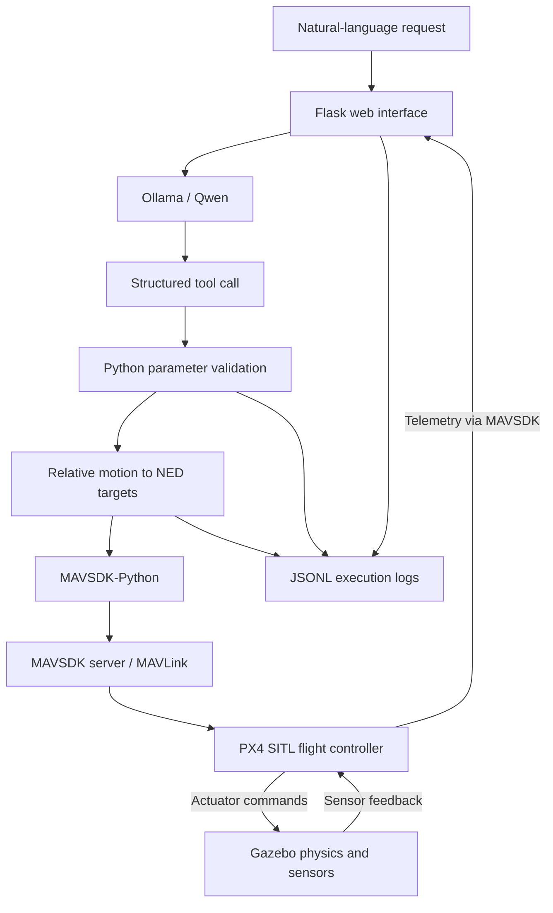

# LLM Drone Simulation

Natural-language flight planning with a local LLM, PX4 flight control, and Gazebo 3D physics simulation.

The application converts a user request into a structured tool call, validates its parameters, and executes a bounded flight sequence through MAVSDK. A web interface displays the request, tool arguments, execution status, and telemetry. Structured logs capture each transformation from language to flight commands.

**[Watch the demo](LLM_Drone_Demo_1080p.mp4)** · **[Inspect a recorded run](logs/20261103-210836/events.jsonl)**

The recording shows an actual simulated takeoff, forward movement, rotation, and landing. It is a 65-second, 1920 × 1080 H.264 video. Download the MP4 if inline playback is unavailable. The recorded interface and input are in Traditional Chinese.

## Architecture



| Component | Role |
| --- | --- |
| **Qwen 2.5 1.5B** | Language model that maps a request to the predefined flight-plan tool and its arguments. |
| **Ollama** | Local model runtime exposing the inference HTTP API. |
| **Python application** | Validates the plan, converts coordinates, sequences flight actions, and records execution. |
| **Flask** | Web framework serving the interface and task/status endpoints. |
| **MAVSDK-Python** | Control SDK providing takeoff, position targets, landing, and telemetry APIs. |
| **MAVLink** | Protocol carrying commands, setpoints, and telemetry between MAVSDK and PX4. |
| **PX4** | Flight-control software that estimates vehicle state and continuously controls position, attitude, and actuator output. |
| **Gazebo Harmonic** | Simulates the vehicle dynamics, environment, and sensors, and renders the 3D scene. |

PX4 runs in **Software-in-the-Loop (SITL)** mode: the flight-control software executes on the computer and exchanges actuator commands and sensor data with Gazebo. No physical flight-controller board or drone is required.

The LLM supplies high-level mission parameters once per task. PX4 closes the feedback loop throughout flight. In Offboard mode, the application supplies position and heading targets while PX4 continues stabilizing the vehicle.

## From language to flight

The supported sequence is:

```text
takeoff → move forward relative to heading → rotate in place → land
```

For example, a request to take off to 3 meters, move forward 5 meters, rotate 90 degrees clockwise, and land is represented by this tool call:

```json
{
  "function": {
    "name": "execute_flight_plan",
    "arguments": {
      "takeoff_altitude_m": 3,
      "forward_distance_m": 5,
      "yaw_clockwise_deg": 90,
      "land": true
    }
  }
}
```

Function calling produces structured data; the application must validate and execute it. The accepted parameters are:

| Parameter | Constraint |
| --- | --- |
| `takeoff_altitude_m` | 1–5 m |
| `forward_distance_m` | 0–10 m |
| `yaw_clockwise_deg` | −180° to +180°; positive means clockwise |
| `land` | Must be the Boolean value `true` |

The validator also checks the tool name, expected fields, numeric types, and finite values. Valid parameters do not guarantee that the model interpreted the request correctly.

### Coordinate conversion

Position commands use **NED: North, East, Down**. Heading is measured clockwise from north. Forward movement uses the vehicle heading at the start of the movement stage; it is not a fixed world-axis displacement.

```text
north_target = north_start + distance × cos(heading)
east_target  = east_start  + distance × sin(heading)
down_target  = -takeoff_altitude
yaw_target   = (heading + clockwise_rotation) mod 360
```

Angles are converted to radians for the trigonometric calculations. Height is relative to the local NED origin near the launch point, not sea level. An unspecified rotation direction defaults to clockwise.

In the recorded run, the initial heading was 95.81°. The 5 m forward movement therefore targeted approximately `north=-0.50835`, `east=4.97910`, and `down=-3`, followed by a heading target of `185.81°`.

### SDK execution and feedback

The following excerpt illustrates the command sequence; initialization and telemetry checks are omitted:

```python
await drone.action.set_takeoff_altitude(3)
await drone.action.arm()
await drone.action.takeoff()

# After reaching the takeoff altitude, seed a position target.
await drone.offboard.set_position_ned(current_position_setpoint)
await drone.offboard.start()

await drone.offboard.set_position_ned(
    PositionNedYaw(-0.50835, 4.97910, -3, 95.81)
)
# Hold the movement target, then rotate while retaining position.
await drone.offboard.set_position_ned(
    PositionNedYaw(-0.50835, 4.97910, -3, 185.81)
)

await drone.offboard.stop()
await drone.action.land()
```

MAVSDK-Python communicates with its bundled MAVSDK server through gRPC. The server sends MAVLink commands and setpoints to PX4 over local UDP port `14540`. MAVSDK maintains the Offboard setpoint stream; the application samples telemetry during each stage. Landing completion is determined from PX4 telemetry.

## Setup

### Requirements

The demonstrated stack uses Ubuntu 24.04 under Windows 11 with WSL2/WSLg, Python 3.12, PX4 v1.16.0, Gazebo Harmonic 8.15.0, MAVSDK-Python 3.10.2, and Ollama with `qwen2.5:1.5b`.

Run the commands below in Ubuntu. Keep the source, build, and runtime directories on the Linux filesystem. A graphical session is required for Gazebo visualization; recording additionally requires X11 capture support.

### 1. Get the source and simulator

```bash
mkdir -p ~/projects
cd ~/projects
git clone https://github.com/yslin1013/llm-drone-simulation.git

git clone --branch v1.16.0 --depth 1 --recurse-submodules --shallow-submodules \
  https://github.com/PX4/PX4-Autopilot.git ~/PX4-Autopilot

git -C ~/PX4-Autopilot/platforms/nuttx/NuttX/nuttx fetch --tags
```

### 2. Install dependencies and build PX4

The upstream setup script installs system packages and configures Gazebo package sources. Review it before running; the application uses a separate Python virtual environment.

```bash
less ~/PX4-Autopilot/Tools/setup/ubuntu.sh
sudo bash ~/PX4-Autopilot/Tools/setup/ubuntu.sh --no-nuttx
sudo apt-get install ffmpeg xdotool fonts-noto-cjk python3-venv rsync curl zstd

cd ~/PX4-Autopilot
make px4_sitl_default -j4
```

Install Ollama using its [Linux installation instructions](https://ollama.com/download/linux), start its service, and install the application:

```bash
cd ~/projects/llm-drone-simulation
bash scripts/install_runtime.sh
```

The script copies the application to `~/llm-drone-demo-runtime/app`, creates `~/llm-drone-demo-runtime/.venv`, installs Python dependencies and Playwright Chromium, and pulls `qwen2.5:1.5b`. Run it again after source changes to refresh the runtime copy. Existing logs and MP4 files are excluded from synchronization.

### 3. Start the demo

Confirm that Ollama is available:

```bash
curl http://127.0.0.1:11434/api/tags
```

If the service is not running, start `ollama serve` in a separate terminal.

Start the simulator:

```bash
bash ~/llm-drone-demo-runtime/app/scripts/start_simulator.sh
```

Once the vehicle appears in Gazebo, start the application in another terminal:

```bash
bash ~/llm-drone-demo-runtime/app/scripts/start_app.sh
```

Open **http://127.0.0.1:8000**, submit the prefilled request, and follow the tool call and execution status. The current interface is in Traditional Chinese. After landing, stop the application and simulator with `Ctrl+C` in their respective terminals.

### Configuration

| Variable | Default | Purpose |
| --- | --- | --- |
| `LLM_PROVIDER` | `ollama` | Inference provider; `openai` selects the optional cloud implementation. |
| `OLLAMA_URL` | `http://127.0.0.1:11434` | Ollama API endpoint. |
| `OLLAMA_MODEL` | `qwen2.5:1.5b` | Local model identifier. |
| `OPENAI_MODEL` | `gpt-4.1-mini` | Model for the optional cloud implementation. |
| `OPENAI_API_KEY` | Unset | Credential required only for the cloud implementation. |

The demonstrated workflow uses local inference and requires no cloud API key. The cloud implementation has not been validated end to end. Supply credentials through the environment, never through source files.

## Execution logs

Each task writes `logs/YYYYMMDD-HHMMSS/events.jsonl` inside the runtime application directory. Each line is a JSON event.

| Stage | Recorded content |
| --- | --- |
| `natural_language` | Original request. |
| `llm_response` | Model response and tool call. |
| `validated_plan` | Accepted flight parameters and action order. |
| `coordinate_conversion` | Starting position, heading, and computed targets. |
| `sdk_command` | SDK method and arguments. |
| `state` | Execution progress and selected telemetry. |
| `flight_measurement` | Measured displacement, height, heading change, and position error. |
| `result` | Final outcome and landing status. |
| `recovery` / `recovery_error` | Landing recovery request or its failure, when applicable. |

These are application-level and SDK-level records, not raw MAVLink packet captures. Repeated setpoints are not individually logged. Two example runs are included; newly generated logs are ignored by Git by default.

## Validation

The [recorded run](logs/20261103-210836/events.jsonl) produced the following telemetry:

| Measurement | Target | Observed |
| --- | --- | --- |
| Height | 3 m | 3.008 m |
| Forward displacement | 5 m | 4.983 m |
| Clockwise heading change | 90° | 89.5° |
| Horizontal target error | — | 0.021 m |
| Landing | On ground | `in_air=false` |

These values describe one simulated run, not a general accuracy guarantee.

Run parameter-validation tests with:

```bash
source ~/llm-drone-demo-runtime/.venv/bin/activate
cd ~/llm-drone-demo-runtime/app
python -m unittest -v test_validation
```

The unit tests check accepted and rejected parameters without commanding flight.

## Recording

With Ollama, the simulator, and the application running:

```bash
source ~/llm-drone-demo-runtime/.venv/bin/activate
cd ~/llm-drone-demo-runtime/app
python scripts/record_ui.py
bash scripts/compose_video.sh
```

The recorder submits a flight task, captures the Gazebo window with FFmpeg, and records the web interface with Playwright. Raw clips are saved under `~/llm-drone-demo-runtime/recordings`; the composed MP4 is written to the runtime application directory.

The composition crop assumes the original 1000 × 845 Gazebo window layout associated with `config/gui.config`. Adjust the crop before recording with a different window size or panel arrangement. The final video is 30 FPS; the web recording is converted from 25 FPS, and the two captures are not frame-synchronized.

## Troubleshooting

| Symptom | Action |
| --- | --- |
| Ollama connection refused | Check `/api/tags`; start the service with `ollama serve` if needed. |
| Model unavailable | Run `ollama pull qwen2.5:1.5b`. |
| Slow first request | Allow time for model loading; check available memory and CPU load. |
| Blank Gazebo scene | Check WSLg/display support. The launch script selects the Ogre renderer for compatibility. |
| Incorrect page at port 8000 | Check for a port conflict. If changing the application port, also update the recorder URL. |
| Missing glyphs | Install `fonts-noto-cjk` and restart the browser. |
| NuttX version-header build error | Fetch the NuttX submodule tags, then rebuild PX4. |
| Flight waits before takeoff | Check PX4 position estimation and sensor readiness; avoid duplicate simulator instances. |

## Scope and limitations

- Simulation-only, single-user application with one fixed four-stage mission sequence. No obstacle avoidance or multi-waypoint planning.
- Forward motion and rotation use fixed hold durations of 8 and 6 seconds. Completion is not governed by an adaptive target-error threshold.
- The demonstrated prompt is included in the model instructions; the recording is not a broad language-understanding benchmark.
- Flight execution has a 150-second timeout and attempts landing on an exception. Recovery behavior has not been validated through fault injection.
- The included recording predates subsequent logging and recovery changes. Those changes received syntax and parameter-test checks, not a new full flight verification.
- The web server binds to loopback and has no authentication or production deployment configuration.
- Clean-machine installation and alternative operating-system configurations have not been independently validated. Direct application dependencies are pinned; transitive dependencies are not fully locked.

## Project layout

```text
app.py                       Planning, validation, control, telemetry, and API
requirements.txt             Direct Python dependencies
templates/index.html         Web interface
test_validation.py           Parameter-validation tests
scripts/install_runtime.sh   Runtime setup
scripts/start_simulator.sh   PX4 and Gazebo startup
scripts/start_app.sh          Application startup
scripts/record_ui.py          Simulator and interface capture
scripts/compose_video.sh      Video composition
config/gui.config            Reference Gazebo GUI configuration
logs/                        Recorded example runs
LLM_Drone_Demo_1080p.mp4       Demonstration video
```

## References

- [PX4 development environment](https://docs.px4.io/v1.16/en/dev_setup/dev_env_linux_ubuntu)
- [Gazebo Harmonic](https://gazebosim.org/docs/harmonic/)
- [MAVSDK Offboard control](https://mavsdk.mavlink.io/main/en/cpp/guide/offboard.html)
- [MAVLink](https://mavlink.io/en/)
- [Ollama tool calling](https://docs.ollama.com/capabilities/tool-calling)

Third-party software and model weights remain subject to their respective licenses. This repository does not currently include a project license.
